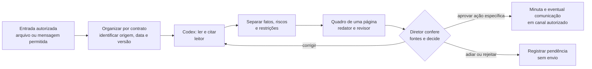

# 8. Da informação à decisão: mapa do primeiro piloto

**Estado:** rascunho para validação de Francisco. **Data:** 05/11/2026. **Responsável pelo texto:** Codex; Lucas e Francisco decidem o escopo do piloto.

## O que o diretor deve conseguir fazer

Em um contrato escolhido, transformar um reporte de gerente e um marco contratual em **um quadro curto, rastreável e revisável**. O exercício usa arquivos fictícios deste repositório. Os sistemas citados abaixo são canais possíveis, não conexões instaladas na conta de Francisco.

A imagem mostra **uma arquitetura candidata**. No exercício, a entrada é um arquivo fictício local e a organização é manual. As caixas de WhatsApp, e-mail e Google Drive mostram de onde informações *poderiam* vir em uma etapa real autorizada; não indicam captura, sincronização ou pasta já criada. O acompanhamento é uma próxima verificação humana, não automação ativa.

| Etapa | Na demonstração fictícia | Para um contrato real | Evidência de que funcionou |
| --- | --- | --- | --- |
| 1. Entrada | `exemplos/contrato-ficticio.md`, `reporte-gerente-ficticio.md`, `mensagem-ficticia.md` e matriz | Francisco escolhe um contrato, fontes e período; proprietário dos dados autoriza o acesso | Lista de fontes permitidas, origem, data, versão e responsável pelo acesso |
| 2. Organização | Todos os arquivos permanecem em `exemplos/`, identificados como DEMO-001 | Manter originais na pasta ou sistema aprovado do contrato; separar cópias de trabalho e registrar caminho, sem mover automaticamente | Cada fonte pode ser reaberta na versão citada |
| 3. Leitura | Papel `01-leitor` extrai fatos e lacunas | Codex lê somente os arquivos ou canais autorizados, no menor escopo necessário | Tabela de fatos com arquivo, trecho e data; itens não lidos ficam marcados |
| 4. Restrições | Papel `02-restricoes` compara reporte, mensagem e marco | Gerente confirma estado da ordem de serviço; impacto e responsável que faltarem continuam hipóteses | Risco, restrição confirmada e pergunta não são confundidos |
| 5. Quadro | Papéis `03-redator` e `04-revisor` preenchem `modelos/quadro-semanal.md` | O diretor recebe uma página com evidências e decisões pendentes | Datas e afirmações conferidas nas fontes; divergências visíveis |
| 6. Revisão | Diretor simulado aprova, corrige, rejeita ou pede fonte | Francisco decide o encaminhamento e registra sua decisão no local aprovado | Há pessoa, data, escopo e referência da aprovação quando houver |
| 7. Comunicação | `prompts/03-minuta.md` gera apenas texto `RASCUNHO — NÃO ENVIADO` | Envio exige autorização específica para destinatário, conteúdo, anexos e canal; registrar comprovante depois | Rascunho e envio têm estados diferentes; sem comprovante, não declarar enviado |

## Sistemas: papel e limite no piloto

| Sistema ou meio | Papel possível | Situação deste kit |
| --- | --- | --- |
| Arquivos locais de exemplo | Demonstrar o ciclo inteiro sem dados de cliente | Disponíveis; não há integração externa |
| ChatGPT para Windows, modo Codex | Ler arquivos autorizados, aplicar os quatro papéis e produzir rascunhos | Acesso e comportamento na conta/computador de Francisco ainda não testados |
| Pasta aprovada do contrato ou Google Drive | Guardar originais e versões por contrato | Estrutura e permissões reais a confirmar; nenhuma pasta é criada por este kit |
| E-mail, WhatsApp e Agenda | Fontes ou canais de ação futura | Nenhuma conexão na conta de Francisco foi demonstrada; entrada manual deve ser rotulada |
| NotebookLM | Consulta complementar a fontes, se Francisco usar e aprovar | Uso e existência de notebook por contrato não verificados; não é necessário para o primeiro quadro |
| Hermes | Arquitetura anterior de captura, organização e automação | Guia histórico, sem implantação comprovada na conta de Francisco; não é requisito do piloto Codex |

## Uma passagem completa com DEMO-001

1. O gerente registra em `reporte-gerente-ficticio.md` que a OS-17 depende de 40 luminárias; a disponibilidade está **não confirmada**. O contrato marca 18/11/2026 para o marco M1. A mensagem de campo pede confirmação até 12/11/2026.
2. O leitor cita cada uma das três fontes. O analista registra a falta de confirmação como restrição para preparar a frente, mas deixa o atraso do marco como **risco**, sem afirmar que ele já ocorreu.
3. O quadro separa **prazo de resposta (12/11)** de **marco contratual (18/11)**. A matriz fictícia identifica o gerente como papel de acompanhamento; não fornece nome nem autorização de envio.
4. O diretor verifica a fonte e escolhe: solicitar confirmação, pedir nova evidência, adiar ou rejeitar. Uma eventual mensagem continua rascunho até a aprovação e o envio serem comprovados fora deste exercício.

## O que aproveitamos das referências anteriores

Do [guia Drive → Hermes de 26 páginas](https://drive.google.com/file/d/1Y9rmUZT62bA0E83sPa_JZnb3jkLigiiZ/view), aproveitamos **como princípio** a separação entre interpretação do modelo e execução verificável pela ferramenta, a organização com regras explícitas e a prova de que uma ação ocorreu. Não importamos Railway, OAuth, cron, servidores MCP ou pareamento de WhatsApp para este primeiro piloto. O Caderno E1 de 61 páginas, preservado na pasta original de Lucas, descreve uma jornada técnica de captura e entregas futuras; essa arquitetura não comprova que os canais estejam operando para Francisco. A origem e os limites das duas fontes estão em [Histórico e fontes](06-historico-e-fontes.md).

Se uma automação de organização vier a ser proposta depois, ela deverá **listar antes de criar**, mostrar o destino ao responsável, pedir autorização de escrita e recusar sobrescrita silenciosa de arquivo com mesmo nome. Repetir a mesma operação não deve criar duplicatas nem alterar um original. O piloto atual só lê as fontes de exemplo e produz rascunhos; não executa essa automação.

## Ponto de passagem para um caso real

Antes de abrir qualquer documento real, preencher a [checagem de segurança](02-seguranca.md) e a [matriz de canais](04-integracoes.md). O primeiro teste real deve registrar: contrato e período; lista de fontes e versões; conta e permissões; local de processamento e armazenamento; quem pode ver o quadro; decisão do diretor. Sem esses dados, permanecer nos exemplos fictícios.
